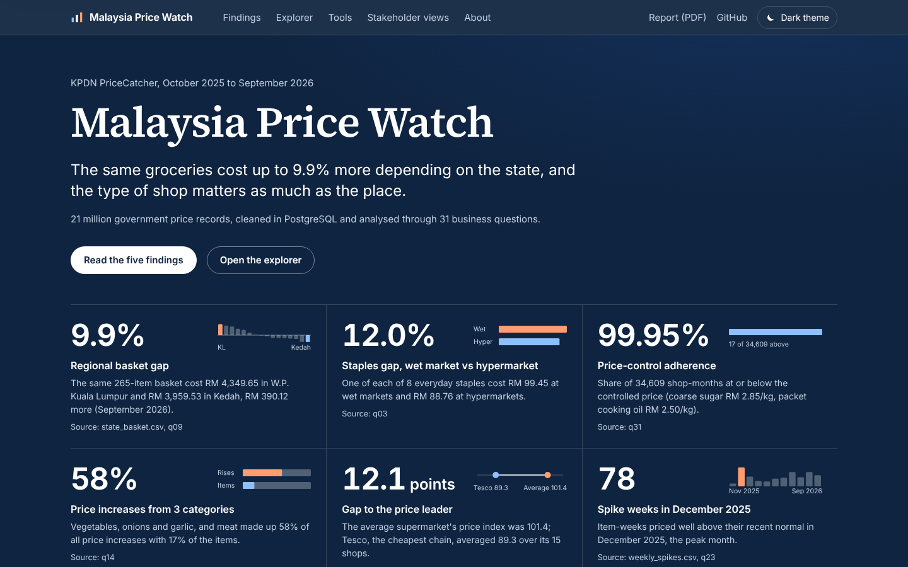
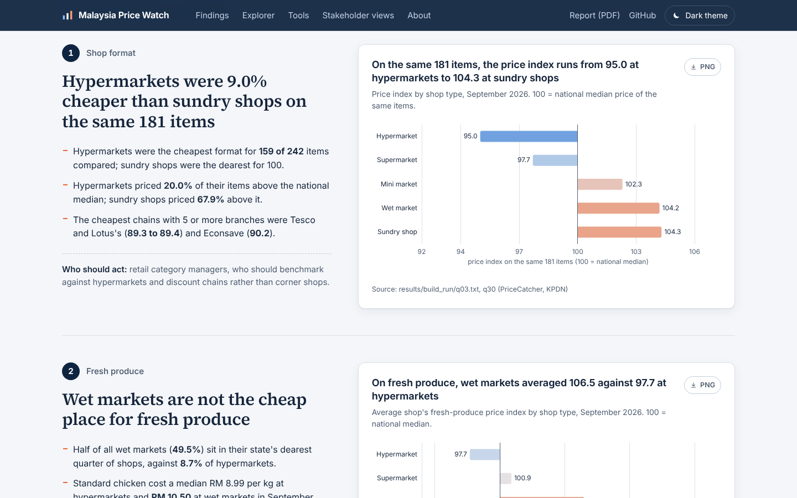
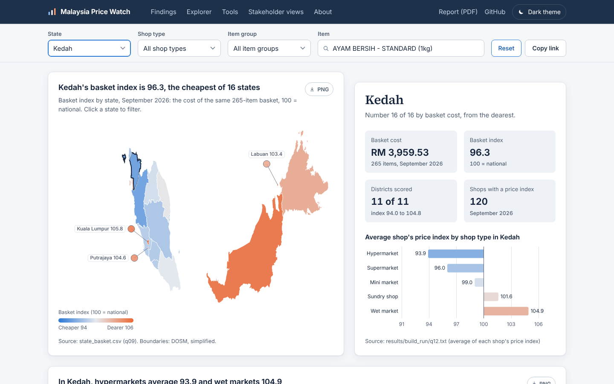
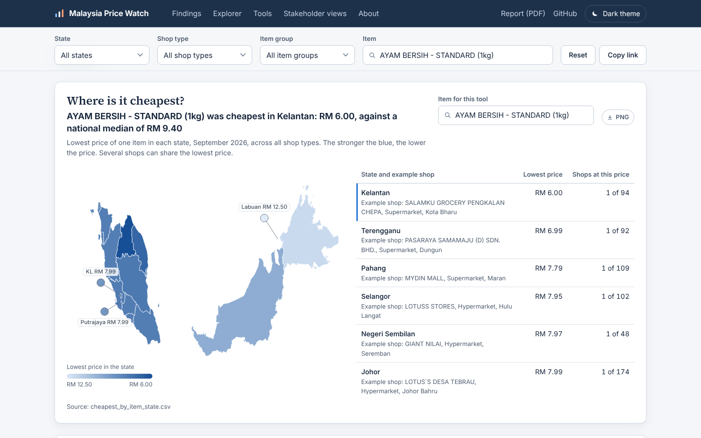
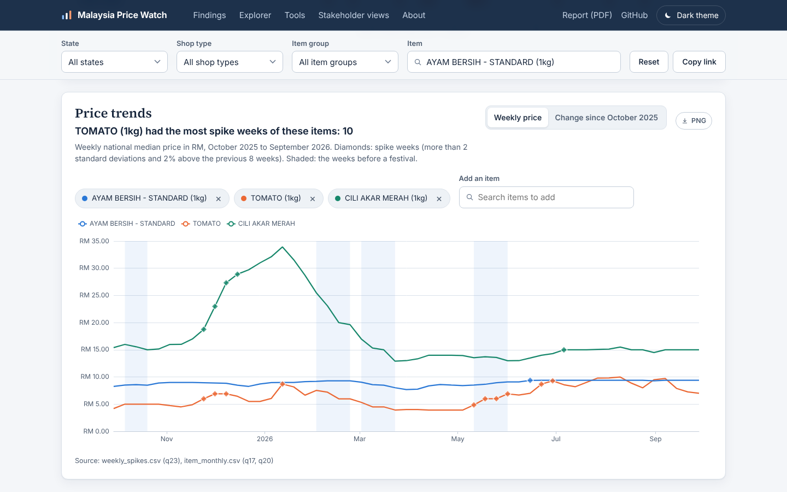
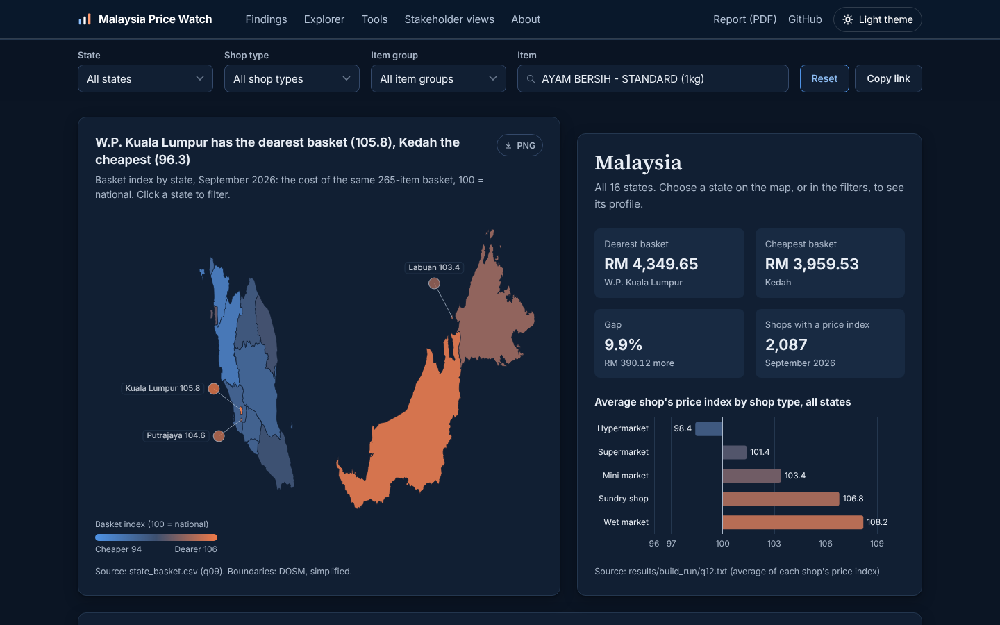

# Malaysia Price Watch

**What 21 million government grocery prices say about where Malaysians pay more, and why: a PostgreSQL analysis with a web dashboard and a Power BI project.**

[](LICENSE)
[](https://www.postgresql.org/)

**[Live dashboard](https://moz700.github.io/malaysia-price-watch/dashboard/)** · **[Power BI report](powerbi/)** · **[Read the report (PDF)](report/Malaysia_Price_Watch_Report.pdf)**



PriceCatcher is the daily price surveillance dataset run by KPDN (Ministry of Domestic Trade and Cost of Living) with DOSM. This project loads a full year of it (October 2025 to September 2026) into PostgreSQL, cleans it with seven documented quality checks, models it as a star schema, and answers 31 business questions for three stakeholders.

Data lineage for every headline number: [`docs/data_lineage.md`](docs/data_lineage.md).

## At a glance

The six headline KPIs, as shown on the dashboard. Snapshot figures use September 2026.

| KPI | Result | What it means | Source |
|---|---:|---|---|
| Regional basket gap | **9.9%** | The same 265-item basket cost RM 4,349.65 in Kuala Lumpur and RM 3,959.53 in Kedah, RM 390.12 more | `q09` |
| Staples gap, wet market vs hypermarket | **12.0%** | One unit of each of 8 everyday staples cost RM 99.45 at wet markets and RM 88.76 at hypermarkets | `q03` |
| Price-control adherence | **99.95%** | Share of 34,609 shop-months at or below the controlled price (coarse sugar RM 2.85, packet cooking oil RM 2.50) | `q31` |
| Price increases from 3 categories | **58%** | Share of all price increases from 3 fresh categories (vegetables, onions and garlic, meat), which are 17% of the items | `q14` |
| Gap to the price leader | **12.1 points** | The average supermarket scored 101.4 on the price index; Tesco, the cheapest chain, scored 89.3 | `q12`, `q11` |
| Spike weeks in December 2025 | **78** | Item-weeks priced well above their recent normal; December 2025 had more than any other month | `q23` |

The price index compares a shop's prices with the national median of the same items (100 = national median; below 100 is cheaper).

## The business problem

Malaysian households, retailers and suppliers all ask the same thing: where and when do grocery prices differ, and by how much? PriceCatcher holds the answer, but it arrives as 21 million raw rows with uneven reporting. This project turns it into answers for three readers.

Each stakeholder, the question they bring, and the decision it supports.

| Stakeholder | Their question | Decision it supports |
|---|---|---|
| A. Consumer and policy analyst, KPDN | Which states, districts and items are least affordable, and are controlled prices kept? | Where to focus price enforcement and monitoring |
| B. Retail category manager, supermarket chain | How do our formats and chains price against competitors? | Which items and formats to price against, and where to run promotions |
| C. Procurement analyst, FMCG supplier | Which items are volatile, seasonal or regionally uneven? | Which items need flexible contracts or hedging, and when |

## Key findings

The full write-up, with method notes, is in [`docs/findings.md`](docs/findings.md).

### 1. Shop format matters: hypermarkets were 9.0% cheaper than sundry shops on the same 181 items

On the 181 items sold in all five formats, the price index ran from 95.0 at hypermarkets to 104.3 at sundry shops (September 2026).

### 2. Wet markets are not the cheap option for fresh produce

Shops' fresh-produce prices averaged 106.5 at wet markets, against 97.7 at hypermarkets and 100.9 at supermarkets. Half of all wet markets (49.5%) sit in their state's dearest quarter of shops.

### 3. Location matters too: the same basket costs 9.9% more in Kuala Lumpur than in Kedah

The 265-item basket cost RM 4,349.65 in Kuala Lumpur and RM 3,959.53 in Kedah. Districts inside one state differed by up to 11.7 index points (Kuala Lumpur), and 30 districts had three or fewer reporting shops, 22 of them in Sabah or Sarawak.

### 4. Inflation was narrow: 84% of items moved less than 5% in a year

242 of 288 items, tracked in the same shops, moved less than 5% between October 2025 and September 2026. Vegetables, onions and garlic, and meat made up 58% of all increases with 17% of the items.

### 5. No festive price hike in 2026: the spikes came in December

In the two weeks before Chinese New Year and Hari Raya Aidilfitri, festive staples got cheaper on average (−2.4% and −5.0%), more than other items. December 2025 had the most spike weeks of the year (78, 74 of them fresh produce).

## Dashboards

### Web dashboard

A static, interactive dashboard built from the 8 CSV files in [`dashboard/data/`](dashboard/data/). It runs at the [live link](https://moz700.github.io/malaysia-price-watch/dashboard/) and also offline: double-click `dashboard/index.html`.

What a visitor can do:

- Read the five findings in order, each with the chart behind it and who should act on it.
- Explore by state on a map of Malaysia: click a state, or filter by state, shop type, item group and item, and every chart follows, including a state by shop-type heatmap of the price index. The address bar keeps the selection, so a copied link opens the same view.
- Find where an item is cheapest: the lowest price in each state, how many shops charge it and an example shop.
- Compare two states side by side, and overlay up to four items' prices across the year with spike weeks marked and festive periods shaded.
- Open the stakeholder views for KPDN, a supermarket and a procurement team, switch to the dark theme, and download any chart as a PNG.











On a phone the page stacks into one column: [phone screenshot](dashboard/screenshots/phone.png).

### Power BI report

Saved as a Power BI Project (PBIP), with the semantic model in TMDL and the report in PBIR, so every change is reviewable in Git.

- **Model:** the same 8 CSV files as fact tables, plus State, Item, Shop type and Month dimension tables, loaded from this repo by one shared Power Query function, or from a local folder.
- **Measures:** a `_Measures` table with the 6 KPIs, grain-safe medians that return blank instead of adding pre-computed medians, and the festive change weighted by matched pairs (as in q21).
- **Pages:** Overview, Households and policy, Retail pricing and Cost risk, mirroring the web dashboard. How to open it: [`powerbi/README.md`](powerbi/README.md).

## Data

The four public sources this project uses.

| Source | What it is | Licence |
|---|---|---|
| [PriceCatcher](https://data.gov.my/data-catalogue/pricecatcher), 12 monthly files | `date, premise_code, item_code, price` (RM) | CC BY 4.0 |
| [lookup_item](https://data.gov.my/data-catalogue/lookup_item) | item name, unit, group, category | CC BY 4.0 |
| [lookup_premise](https://data.gov.my/data-catalogue/lookup_premise) | shop name, type, state, district | CC BY 4.0 |
| [CPI by state](https://open.dosm.gov.my/data-catalogue/cpi_state) (DOSM) | monthly CPI by division, 2010 = 100 | CC BY 4.0 |

Raw files are not in the repo (about 545 MB). `data/download.ps1` (Windows) or `data/download.sh` (Mac/Linux) downloads all 15.

The data is not covered by this repo's MIT licence; it keeps its source licence (CC BY 4.0).

**Caveat:** data.gov.my states that PriceCatcher is built for price surveillance, not to measure inflation; DOSM's CPI is the official measure. This project uses CPI only as a consistency check (q27).

## How it is built

The pipeline runs in four schemas, one per stage, so raw data is never edited in place.

| Schema | Holds | Built by |
|---|---|---|
| `staging` | the 15 CSVs exactly as published (21,039,347 price rows) | `sql/00_setup`, `sql/01_load` |
| `ref` | DOSM CPI by state | `sql/01_load` |
| `core` | cleaned star schema: `fact_price` (20,722,545 rows), `fact_premise_item_month`, `dim_item`, `dim_premise`, `dim_date`, `dim_festival` | `sql/03_model` |
| `mart` | 6 views and 1 materialized view that feed both dashboards | `sql/05_views` |

The entity-relationship diagram is defined in [`docs/erd.dbml`](docs/erd.dbml) (DBML; paste it into dbdiagram.io to view it).

### Data quality

Seven checks, each its own file in `sql/02_quality/`. This table shows how many rows each rule removed. Full report: [`docs/data_quality_report.md`](docs/data_quality_report.md).

| Check | Rows |
|---|---:|
| Price missing or below RM 0.10 | 76 |
| Item code missing from the published item list | 313,598 |
| Premise code missing from the premise list | 13 |
| Duplicate or conflicting prices | 0 |
| Outliers (above 5x or below 1/5 of the item's monthly median) | 3,115 |
| **Removed in total** | **316,802 (1.51%)** |

### Three traps in this data, and how the analysis avoids them

1. **Shops report at very different rates.** In September 2026 a wet market reported each item about 15 times in the month, a sundry shop about 3 times. A median over raw rows lets frequent reporters outvote the others: for 123 of 329 items it gave a different national median than counting each shop once. The fix is `core.fact_premise_item_month`, which holds one price per shop per item per month.
2. **The set of reporting shops changes.** 234 premises joined late or stopped early. Year-on-year and pre-festival changes are measured on matched shops, the same shop and item in both periods; the naive method misstated the year's change by more than 2 points for 82 of 288 items.
3. **Collection is concentrated on Mondays.** 42.3% of all rows are Monday prices (over 90% for mini markets and sundry shops), so a public-holiday Monday empties a week. Spike detection uses weekly series with a minimum-coverage filter, not daily ones.

### Performance

The before and after timings, from the build run (`results/build_run/run_all_log.txt`).

| Test | Before | After |
|---|---:|---:|
| One item's daily median for the whole year, after a composite index on `fact_price (item_code, date)` | 2.97 s | 0.09 s |
| One item in one month (a dashboard filter) | 43 ms | 5 ms |
| Weekly spike view: normal view vs materialized view | 52.5 s | 0.05 s |

Timings depend on the machine and on what is already cached in memory; rerun `sql/03_model/05_indexes_and_timing.sql` to measure on yours.

## The 31 questions

The questions, grouped by SQL technique. Each file in `sql/04_analysis/` opens with its stakeholder, question, method and answer; the full list, mapped to stakeholders, is in [`docs/stakeholders_and_questions.md`](docs/stakeholders_and_questions.md).

| Group | Questions | SQL used |
|---|---|---|
| 1. Aggregation and joins | q01–q08 | JOIN, GROUP BY, HAVING, PERCENTILE_CONT, FILTER, anti-joins |
| 2. CTEs and subqueries | q09–q14 | multi-step CTEs, correlated subqueries, ratio metrics, running shares |
| 3. Window functions | q15–q25 | ROW_NUMBER, RANK, DENSE_RANK, NTILE, LAG, rolling AVG, FIRST_VALUE / LAST_VALUE |
| 4. Reporting and checks | q26–q31 | GROUPING SETS, CPI correlation, gap detection with generate_series, findings table, KPI checks |

## Skills shown

Where each skill appears in the repo.

| Skill | Files that show it |
|---|---|
| SQL aggregation, joins and CTEs | `sql/04_analysis/q01`–`q14` |
| Window functions | `sql/04_analysis/q15`–`q25` |
| Advanced SQL (GROUPING SETS, correlation, gap detection) | `sql/04_analysis/q26`–`q31` |
| Data cleaning and quality checks | `sql/02_quality/`, [`docs/data_quality_report.md`](docs/data_quality_report.md) |
| Data modelling (star schema) | `sql/03_model/`, [`docs/erd.dbml`](docs/erd.dbml), [`docs/data_dictionary.md`](docs/data_dictionary.md) |
| Query performance (indexes, materialized views) | `sql/03_model/05_indexes_and_timing.sql`, `sql/05_views/02_materialized_view_timing.sql` |
| Data modelling and DAX in Power BI | [`powerbi/`](powerbi/) |
| Data visualisation | [`dashboard/`](dashboard/), `docs/charts/make_charts.py` |
| Testing and automation | `dashboard/tests/` (browser test), `dashboard/build_data.py` (checks the data against the build output) |
| Business communication | [`report/Malaysia_Price_Watch_Report.pdf`](report/Malaysia_Price_Watch_Report.pdf), [`docs/findings.md`](docs/findings.md) |

## Reproduce

You need PostgreSQL 16 or newer, and Python 3 for the dashboard data. Run every command from the repo root (the `malaysia-price-watch` folder).

**Windows (PowerShell)**

1. Download the data: `powershell -ExecutionPolicy Bypass -File data\download.ps1`
2. Create the database (connected to `postgres`):
   ```powershell
   & "C:\Program Files\PostgreSQL\<version>\bin\psql.exe" -U postgres -d postgres -f sql\00_setup\00_create_database.sql
   ```
3. Build everything (about 15 minutes). The CSVs are read from `data\` by default:
   ```powershell
   & "C:\Program Files\PostgreSQL\<version>\bin\psql.exe" -U postgres -d pricewatch -f "$PWD\sql\run_all.sql"
   ```
   If your CSVs are elsewhere, add `-v datadir="<folder with the 15 CSVs, forward slashes>"`.
4. Run the quality checks in `sql/02_quality/` and the questions in `sql/04_analysis/` one file at a time (DBeaver or psql).
5. Export the dashboard data and rebuild the dashboard file:
   ```powershell
   & "C:\Program Files\PostgreSQL\<version>\bin\psql.exe" -U postgres -d pricewatch -f sql\05_views\03_export_dashboard_data.sql
   python dashboard\build_data.py
   ```
6. Open `dashboard\index.html` in a browser. Open `powerbi\MalaysiaPriceWatch.pbip` in Power BI Desktop and click Refresh (see [`powerbi/README.md`](powerbi/README.md)).

**Mac/Linux (bash)**

```bash
bash data/download.sh
psql -U postgres -d postgres -f sql/00_setup/00_create_database.sql
psql -U postgres -d pricewatch -f "$PWD/sql/run_all.sql"      # add -v datadir="<folder>" if the CSVs are elsewhere
psql -U postgres -d pricewatch -f sql/05_views/03_export_dashboard_data.sql
python3 dashboard/build_data.py
```

Then open `dashboard/index.html` in a browser. Optional: `python docs/charts/make_charts.py` draws the five finding charts.

## Repository layout

The main folders and what each holds.

```
malaysia-price-watch/
  README.md
  LICENSE                           MIT, for the code only
  report/                           the 11-page stakeholder report (PDF and editable .docx)
  data/download.ps1, download.sh    download the 15 source files (CSVs are git-ignored)
  sql/run_all.sql                   rebuilds staging -> core -> mart in one go
  sql/00_setup/                     database, schemas, staging tables
  sql/01_load/                      \copy load and first look
  sql/02_quality/                   profiling and the 7 quality checks
  sql/03_model/                     dimensions, fact tables, indexes and timing
  sql/04_analysis/                  q01 ... q31, one file per business question
  sql/05_views/                     mart views, materialized view timing, dashboard export
  results/build_run/                output of every script from the build run
  docs/                             findings, data dictionary, quality report, ERD (DBML), chart script, data lineage
  dashboard/index.html              the web dashboard (works offline)
  dashboard/assets/                 style, app code, data.js and ECharts
  dashboard/data/                   the 8 CSV files both dashboards use
  dashboard/build_data.py           rebuilds assets/data.js from the CSVs
  dashboard/tests/                  browser test of the dashboard (Puppeteer drives a real Chrome)
  dashboard/screenshots/            screenshots of the dashboard
  powerbi/                          Power BI project: semantic model (TMDL) and report (PBIR)
```

## Next steps

- Re-download `lookup_item.csv` to recover the 313,598 rows whose item codes the published list does not yet contain.
- Separate the effect of the festive price-control scheme from post-monsoon supply by comparing controlled and uncontrolled items in the same weeks.
- Add DOSM district population data to turn "shops per district" into "shops per 10,000 residents".

## Author

**Moztoba Mutashim Billah** · MSc Business Analytics, Sunway University · [LinkedIn](https://www.linkedin.com/in/moztoba-mutashim-billah) · [GitHub](https://github.com/Moz700)

Code: MIT licence ([`LICENSE`](LICENSE)). Data: PriceCatcher (KPDN, via data.gov.my) and DOSM, CC BY 4.0.
