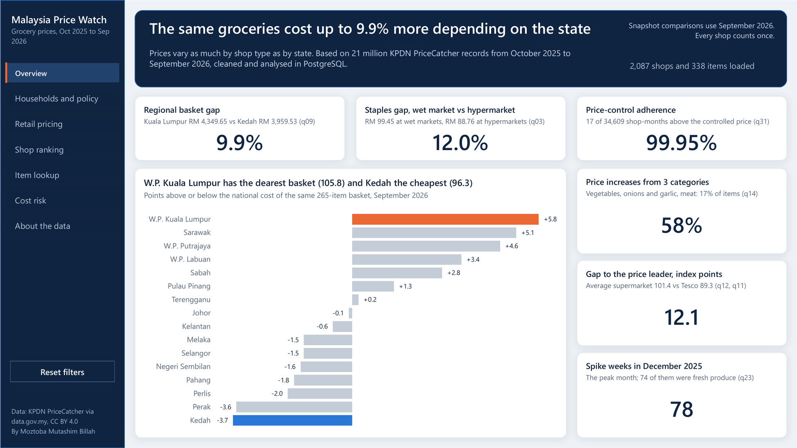
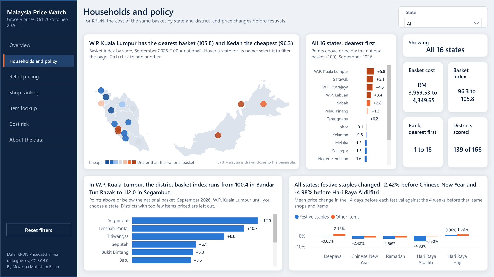
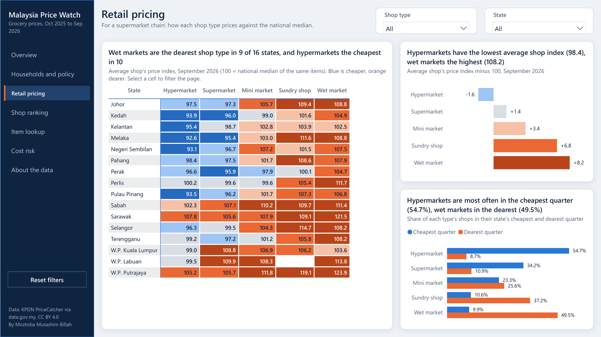
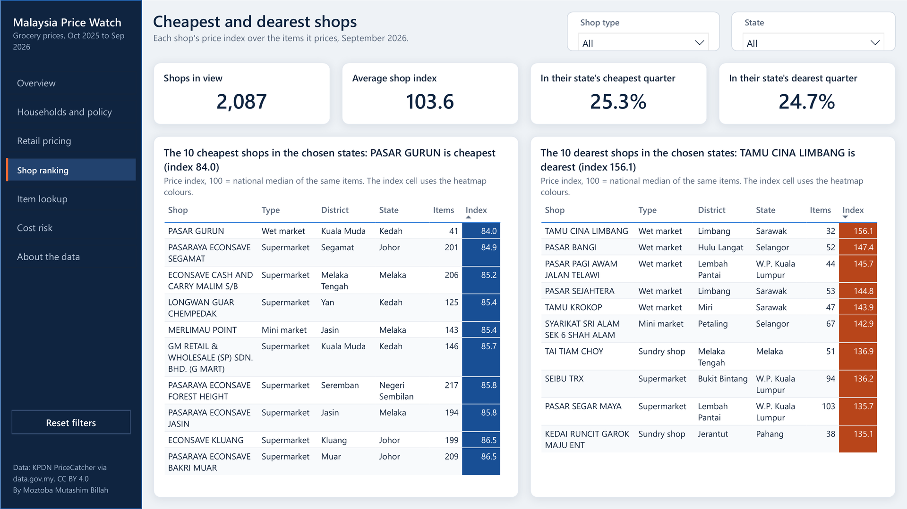
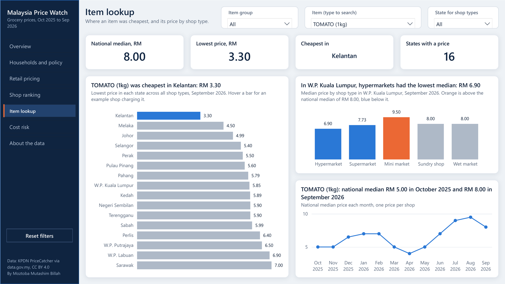
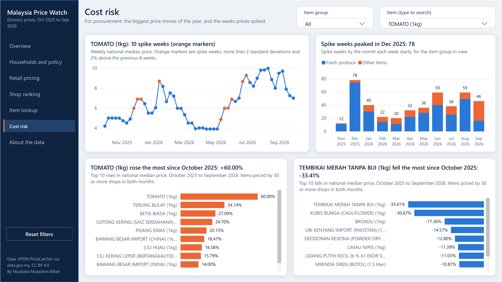
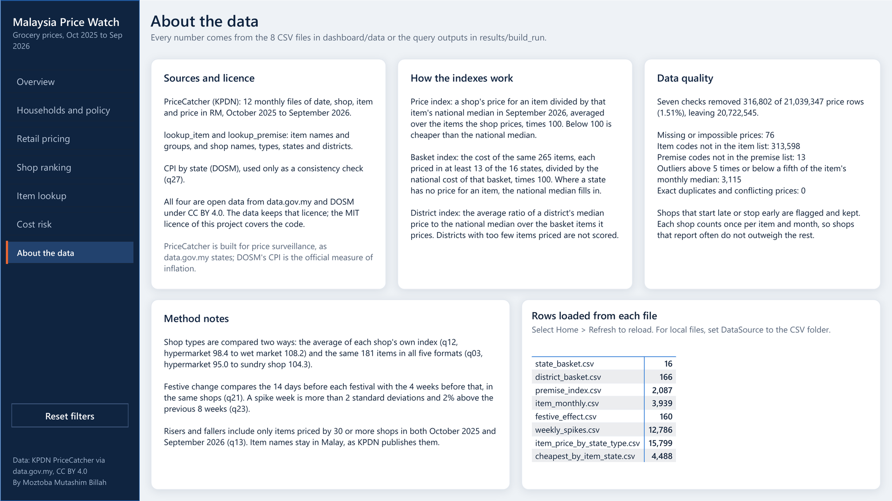

# Power BI report

This folder holds the Malaysia Price Watch report as a Power BI Project (PBIP), with the semantic model in TMDL and the report in PBIR. Both are stored as text, so every change can be reviewed in Git. The report uses the same 8 CSV files as the web dashboard ([`dashboard/data/`](../dashboard/data/README.md)).

## Open it

1. Open `MalaysiaPriceWatch.pbip` in Power BI Desktop (current release).
2. Select **Home > Refresh**. A PBIP keeps no data in Git, so the charts stay empty until the first refresh.
3. If Power BI asks how to connect to `https://raw.githubusercontent.com/`, choose **Anonymous**, then **Connect**. If it asks about privacy levels, choose **Public**.
4. Save with Ctrl+S. Power BI keeps the loaded data in a local cache that Git ignores, so the next time you open the project on this computer it needs no refresh.

The data loads from this repository on GitHub through one parameter, `DataSource`, so the report refreshes on any machine and in the Power BI service without a gateway. To work offline, set `DataSource` to a local folder that holds the 8 CSV files (**Home > Transform data > Edit parameters**), for example `C:\malaysia-price-watch\dashboard\data\`, and refresh. The Overview page shows how many shops and items loaded, or tells you to refresh when nothing has.

## Pages

Seven pages at 1280 x 720 share a navigation rail on the left. Its page navigator marks the current page, and **Reset filters** clears every slicer on the page.

| Page | What it shows | How to use it |
|---|---|---|
| Overview | The headline (the same groceries cost up to 9.9% more depending on the state), the six KPIs, and basket cost by state with W.P. Kuala Lumpur (dearest) and Kedah (cheapest) picked out. | Hover a bar for its values. |
| Households and policy | A map of Malaysia with a marker for each of the 16 states, coloured by basket index; the state ranking; the chosen state's basket cost, index, rank and districts scored; its district range; and the price change before each festival. | Select a state on the map, in the ranking or in the State slicer to filter the page. Tick several states in the slicer to compare them. |
| Retail pricing | A heatmap of the average shop's price index for each state and shop type (the values printed in q12), the index of each shop type, and the share of shops in their state's cheapest and dearest quarter. | Select a heatmap cell to filter the page to that state and shop type. |
| Shop ranking | The 10 cheapest and the 10 dearest shops, with the index cell coloured on the heatmap scale. | Narrow it with the State and Shop type slicers. |
| Item lookup | For one item: the national median, the lowest price and where it was found, the lowest price in each state (an example shop is in the tooltip), the median by shop type against the national median, and the monthly median. | Search for an item; the State slicer sets the state for the shop-type chart. |
| Cost risk | The chosen item's weekly price with spike weeks marked, spike weeks by month for the item group, and the top 10 risers and fallers since October 2025. | Pick an item group and an item. |
| About the data | Sources and licence, how the indexes work, data quality, method notes, and the rows loaded from each file. | |

- Slicers stay in sync across pages: State (Households and policy, Retail pricing, Shop ranking, Item lookup), Shop type (Retail pricing, Shop ranking), and Item and Item group (Item lookup, Cost risk).
- Chart titles are measures, so each title restates the finding for the current selection, for example the chosen state's district range or the chosen item's lowest price.
- The map, the state ranking, the heatmap and the risers and fallers ignore the slicer that would otherwise hide their own rows. The Item slicer does not narrow the Item group list, so every group stays available.
- The State and Shop type slicers show checkboxes, so several values can be ticked at once; the Item slicer takes one item. With several states ticked, the state cards ask for one state and the chart titles say "the chosen states".
- In Power BI Desktop, hold Ctrl when you click the page navigator or the Reset filters button; in the Power BI service a plain click works.
- The map is a scatter chart drawn over an image of the state outlines (`MalaysiaPriceWatch.Report/StaticResources/RegisteredResources/map.png`, made from DOSM's state boundaries), so it needs no internet connection and no map service. Sabah, Sarawak and Labuan are drawn 3.2 degrees closer to the peninsula than they really are.

### Screenshots

Exported from Power BI Desktop after a refresh, with no slicer selections except the default item (TOMATO, 1kg). The same pages are in [`MalaysiaPriceWatch.pdf`](MalaysiaPriceWatch.pdf).

## Design

- The colours follow the charts in the PDF report: blue `#2A78D6` and orange `#EB6834` on navy `#0F2440`. The map, the heatmap and every index bar use one diverging scale: three blues below 100 (cheaper), grey close to 100, three oranges above (dearer). Text on the darkest fills is white.
- The custom theme in `MalaysiaPriceWatch.Report/StaticResources/RegisteredResources` sets the light grey canvas, white cards with rounded corners and a soft shadow, Segoe UI type, the axis and table styles, and the navigation states.

## Model

A star schema: eight fact tables (one per CSV), four dimensions, and one small table copied from the build output.

| Table | Kind | Source file | One row is |
|---|---|---|---|
| State | dimension | state_basket.csv | a state, with a three-letter code and the position of its marker on the map |
| Item | dimension | item_monthly.csv | an item code, with name, unit, group, category and a unique label |
| Shop type | dimension | fixed list | a shop type, in price order |
| Month | dimension | built in Power Query | a month, October 2025 to September 2026 |
| State basket | fact | state_basket.csv | a state |
| District basket | fact | district_basket.csv | a district |
| Shop index | fact | premise_index.csv | a shop |
| Item monthly | fact | item_monthly.csv | an item in a month |
| Festive effect | fact | festive_effect.csv | a festival, state and item set |
| Weekly spikes | fact | weekly_spikes.csv | an item in a week |
| Item price by state and shop type | fact | item_price_by_state_type.csv | an item, state and shop type |
| Cheapest by item and state | fact | cheapest_by_item_state.csv | an item and state |
| Shop type index (q12) | fact | results/build_run/q12.txt | a state and shop type, with the average shop's price index as q12 prints it |

- Every relationship is one-to-many and filters in one direction, from the dimension to the fact. Key columns on the fact tables are hidden.
- One shared Power Query function, `fnLoadCsv`, loads each CSV, promotes the headers, turns empty cells into null in one pass, sets every column type with culture en-US and turns `t`/`f` into true/false.
- Weekly spikes get a hidden "Month of week start" column, so spike weeks are counted by the month of `week_start`, as in q23.
- premise_index.csv rounds each shop's index to 0.1, so a mean taken from it can be 0.1 off the printed q12 value (6 of the 79 state and shop-type pairs). The heatmap and the shop-type bars therefore read q12's printed values when one state and one shop type are in view.

## Measures

All measures are in the `_Measures` table, grouped into display folders; each has a one-line description and, where numeric, a format string.

| Folder | What the measures do |
|---|---|
| KPI | The 6 headline numbers, as fixed values. Each description names its source file in `results/build_run/`. |
| Households and policy | State and district basket cost and index, each also as points above or below 100, the state rank, and the festive price change weighted by matched pairs (as in q21). |
| Retail pricing | The average shop's price index by shop type (as in q12), quarter shares, item prices by shop type and state, and the lowest price of an item in Malaysia. |
| Cost risk | Monthly and weekly median prices, the change since October 2025, and spike weeks. |
| Report | Hidden: fill and text colours, map marker positions, the text of the state and item cards, the data status line, and the rows loaded from each file. |
| Helpers | Hidden: chart titles that follow the selection, and the ranks that keep each top-10 visual at exactly 10 rows. |

- Risers and fallers include only items that 30 or more shops priced in both October 2025 and September 2026, the q13 rule the web dashboard uses. With all items in view, tomatoes rose the most (+60.00%) and seedless watermelon fell the most (-33.41%).
- Medians in the CSV files are pre-computed, so the median measures return blank when a visual would add or average them across items, states, shop types, months or weeks.
- Item names stay as KPDN publishes them (Malay).
